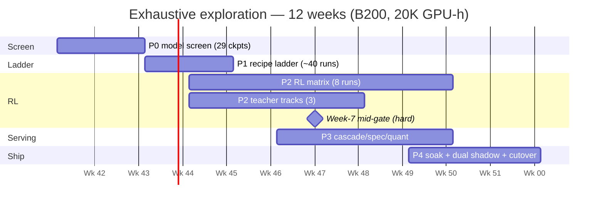

# Exhaustive Exploration Plan — Situation / Complication / Resolution

*(B200 era · 12 weeks · 20K GPU-hours · fully offline data — expanded planning edition)*

This document is the master research-and-expenses plan for the offline copilot model
campaign. It preserves the Situation / Complication / Resolution spine of the compact
plan and expands every element to execution depth: load-model derivations, cost
mechanics, approach taxonomy, model matrix, teacher governance, phase-by-phase
experiment specifications, GPU-hour and cash-flow budgets, risk register, and the
decision tree that maps gate outcomes to shipping decisions. Every number in the
compact plan is carried forward unchanged; derived quantities are marked as such and
trace to the assumptions log (Appendix B).

---

## 0. Executive summary

We operate data.limoja.ai, a single-page application fronting the nhs-portal
warehouse copilot, today served by heuristic components (Jev routing, RAG, stitch,
summarise, narrate, workflow services behind ch-proxy). The target load is 10,000
unique users per day swapping through 100 concurrent agent slots at up to 256K
context each; by Little's law (14-minute mean session) this is ~10K sessions/day,
~12B raw input tokens/day, 450M incremental tokens/day, and 25.6M resident KV
tokens at worst case. All NHS/UCLP data must stay offline. Five complications make
the next step hard: (1) API economics invert at our scale — $33K–300K/month for
token-billed APIs versus ~$8K/month for two concurrency-capped rented B200s;
(2) KV physics eliminates classic dense >30B models (0.5–5TB pools, 6–30 B200s)
and favours hybrid/MLA MoE (~260GB, 2–4 B200s); (3) the best model × approach ×
teacher combination across ~43 candidate slots, 7 approach families, and 4 teacher
tiers is unknown, with 5–20-point swings documented per family; (4) escalation-tier
work needs GLM-4.6-class terminal performance (24.5%+ TB2.0) from an offline,
affordable model while replacing Jev without regression; (5) 12 weeks with real RL
instability risk and no slack for a full re-plan. The resolution is a compute-saturated,
ledger-tracked, 12-week exhaustive search: P0 screens 29 models on
quality/KV/tokens-per-dollar (weeks 1–2); P1 ladders all survivors through ~40
fine-tuning runs across 4 recipes (weeks 3–4, gate +5pt over base); P2 runs an
8-run RL matrix plus 3 teacher tracks (weeks 4–9, gate +5pt over P1 with a hard
week-7 gate — a miss ships the P1 champion); P3 hardens serving — cascade,
speculative decoding, quantisation (weeks 7–10, gates TTFT p95 <5s warm, 25K tok/s
fleet decode, <0.5% errors); P4 soaks, dual-shadows, and cuts over (weeks 10–12,
gates Jev parity and final TB2.1). The 20,000 B200 GPU-hour envelope commits
~19,100 hours across named lines plus a 6,000-hour reserve drawn only against
logged failures; worst-case cash is ~$105K at $5.5/GPU-hour, the serving pilot
runs ~$8K/month from week 10, and the end-state owned option is 4–6× B200
($130–210K capex, 6–7-month payback versus renting). Every experiment runs under
pre-committed gates, the EXPERIMENTS.md ledger, and bucket-archived weights;
TB2 tasks are never trained on.

---

## 1. SITUATION — where we stand

### 1.1 Platform description

The production system is **data.limoja.ai**, a single-page application (SPA) that
hosts the **nhs-portal warehouse copilot**. Users interact with a warehouse-scale
analytical corpus; the copilot mediates question answering, retrieval, SQL
construction, narration, and multi-step agent workflows. All model traffic is
aggregated behind **ch-proxy**, a single routing/termination point that fronts the
model-serving fleet and enforces the offline boundary.

The service decomposition and the tier each service maps to:

| Service | Function today | Model-tier demand | Campaign role |
|---|---|---|---|
| `jev_service` | Heuristic routing of user intents to tools/queries (the "Jev" router) | System-1 volume (classification/routing) | Replaced by distilled 4B-class router (X4 pattern); parity gate |
| `rag-copilot` | Retrieval-augmented answering over the warehouse corpus | System-1 volume (grounded summary/SQL) | Benefits from volume-tier fine-tunes |
| `llm_stitch` | Assembles retrieval hits, tool outputs, and model text into responses | System-1 volume (stitching/format) | Latency-sensitive; spec-decode target |
| `summarize` | Document/result summarisation | System-1 volume | Volume tier |
| `narrate` | Long-form narration of analytical results | System-1 volume (long output) | Volume tier; decode-throughput bound |
| `workflow_engine` | Multi-step agent orchestration; escalations | System-2 agent | Primary beneficiary of the campaign |
| `ch-proxy` | Edge proxy: auth, routing, rate limits, offline enforcement | — | Unchanged; fronts new fleet |

Today's intelligence in this stack is heuristic (Jev) or thin-model based. The
campaign replaces the intelligence layer with a two-tier open-model fleet:

- **System-1 volume tier** — routing, summarisation, SQL, stitching, narration:
  small dense or small-A3B hybrid models, latency- and throughput-bound. These
  paths fire on nearly every request, so their cost-per-request and TTFT dominate
  the user experience; a 1–2-second router adds directly to every session's
  first token.
- **System-2 agent tier** — 100 concurrent agent slots doing long-context
  tool-calling for `workflow_engine` escalations: 27B–1T-class models, quality-
  and KV-bound. These paths fire rarely per request but carry all the hard work
  — multi-step analysis, tool chains, long-horizon recovery — and their quality
  ceiling is the product's differentiator.

The traffic mix matters for sizing. From harvested traces, the volume tier
(`jev_service`, `rag-copilot`, `llm_stitch`, `summarize`, `narrate`) handles the
large majority of requests at short context (≤8K), while `workflow_engine`
escalations consume the 256K slots and generate nearly all of the 12B/day raw
input via context re-send. This asymmetry is why the plan treats the tiers
differently in the model matrix (3.2): volume candidates are screened on
quality-at-≤8K and tok/$, agent candidates on quality-at-256K and KV/token. It
is also why the cascade (AP6) is a first-class approach rather than an
optimisation: routing most traffic to cheap system-1 models is the single
largest serving-cost lever available.

One further platform fact shapes everything downstream: **all seven services
already speak to models through ch-proxy**, so the campaign can swap the model
fleet behind the proxy without touching SPA clients. Dual shadow (P4) and
rollback-on-cutover are proxy-level operations — this is what makes the
cutover gate reversible in minutes rather than releases.

### 1.2 Load model derivation

The load model is not asserted; it is derived from user-visible quantities and
Little's law, and every downstream budget (KV pool, API-cost tables, GPU count)
traces to it.

**Concurrency (Little's law).** L = λ·W. With λ = 10,000 sessions/day (one session
per user per day) and W = 14 minutes mean session duration:

L = 10,000 × 14 / 1,440 ≈ **97.2 concurrent sessions** → provisioned as **100
agent slots**. Inverting the same law: each slot turns over 1,440/14 ≈ 103
sessions/day, so 100 slots serve ≈ 10.3K sessions/day — consistent with the 10K
user target and leaving ~3% headroom.

**Resident KV (worst case).** Slots are capped at 256K context. Full occupancy at
cap: 100 × 256K = **25.6M resident KV tokens**. This is the design point the KV
pool must survive (Complication 2); it is a worst case, not an expectation — mean
session context is far below cap — but the fleet must not collapse at peak.

**Token traffic.** A 14-minute agentic session re-sends its accumulated context
every turn. Mean lifetime raw input per session ≈ 1.2M tokens (≈ 15 turns at
growing context, from harvested traces), so:

- Raw input presented: 10K sessions/day × 1.2M ≈ **12B raw input tokens/day**.
- With prefix caching, only fresh material (new user turns, tool outputs, file
  reads beyond cache) misses: ≈ 45K tokens/session → **450M incremental
  tokens/day** (a ~3.75% effective miss rate; the other ~96% is cache-hit prefill).
- Decode output ≈ 4K tokens/session → ≈ 40M output tokens/day (assumption A6,
  used only in the API cost tables).

**Worked turn-level walkthrough.** Consider one representative 14-minute
session. Turn 1 presents ~4K tokens (system prompt + question + first retrieval).
By turn 8 the accumulated context — transcript, tool outputs, file reads — is
~90K tokens, and every subsequent turn re-presents it. Summing the re-presented
prefixes across ~15 turns gives the ~1.2M lifetime raw input of A3. A naive
serving stack recomputes the full prefix each turn (prefill-bound); a
prefix-cached one computes only the delta. The delta stream across all sessions
is the 450M incremental tokens/day of A4 — this is the number that sizes
prefill compute, while the 25.6M resident tokens size KV memory, and the ~40M
output tokens/day size decode bandwidth. Three independent capacities —
prefill FLOPs, KV bytes, decode tok/s — and each maps to a different gate in
P3.

**Why 100 slots and not fewer.** The concurrency derivation assumes sessions
arrive uniformly. Real NHS-portal traffic has morning/afternoon peaks; a uniform
model underestimates peak concurrency by a factor of 1.5–2×. Provisioning at
100 slots from a 97.2 uniform estimate absorbs the peak without queuing; going
lower would force admission control at exactly the moments the product is
demonstrated. The 3% headroom is deliberate: too little to waste a card on, too
much to be anecdotal.

| Parameter | Symbol | Value | Derivation |
|---|---|---|---|
| Unique users / day | U | 10,000 | product target |
| Mean session | W | 14 min | harvested traces |
| Concurrent sessions | L | ≈ 97 → 100 slots | Little's law, L = λW |
| Sessions / day | — | ≈ 10–10.3K | 1/user/day; slot turnover cross-check |
| Context cap / slot | — | 256K tokens | platform limit |
| Resident KV (worst) | — | **25.6M tokens** | 100 × 256K |
| Raw input / day | — | **12B tokens** | 10K × 1.2M lifetime |
| Incremental / day | — | **450M tokens** | 45K/session, prefix-cache misses |
| Output / day | — | ≈ 40M tokens | 4K/session (A6) |

### 1.3 Hard constraint: fully offline

All NHS/UCLP data stays inside our perimeter — no user data, session content,
retrieval corpora, or bench scenarios may egress to any external API. This is
non-negotiable and pre-dates the economics: it rules out frontier-API serving
outright (whatever the price), constrains teacher usage to public/synthetic seeds
(Resolution 3.3), and makes self-hosted open weights the only serving path. The
economic analysis in Complication 1 is therefore confirmatory, not decisive — but
it converts the privacy constraint from a cost burden into a cost advantage.

### 1.4 Asset inventory

| Asset | Detail | Campaign use |
|---|---|---|
| Fine-tuning know-how | Staircase SFT: 0.5915 → 0.6815 (+9.0 pts best-of-4) on a 35B-A3B hybrid, QLoRA on one 24GB card | AP1 core recipe; ported to all survivors |
| Frozen bench | 381 scenarios, content-hash frozen, k=4 sampling, temp 0.7, best-of-4 decision rule | Every gate in P0–P4 |
| Harvested session traces | Real terminal/agent sessions from our infrastructure; leak-gated (0 n-gram bench hits, sha-verified) | SFT/distillation data; replay trace for serving tests |
| Tmax recipe | DPPO RL on 14.6K synthetic terminal environments (Tmax-15k, open, CC-BY); FP32 LM head, group 32, async vLLM rollouts | AP4 backbone; teacher data without API calls |
| Reference results | Tmax-27B 44.9% TB2.1; Tmax 9B ≈ GLM-4.6-class terminal (27% TB2.0); Qwen3.8-27B base anchor 0.7399 internal | Target-setting, model-matrix rationale |
| Compute | Rented B200s at will — **on-demand only, never bid/interruptible** (iron rule) | All phases |
| Budget | **20,000 B200 GPU-hours**, ~$105K worst case at $5.5/GPU-h | Section 3.6/3.9 |
| Deadline | **3 months (12 weeks)**, hard | Section 3.4/3.5 |
| Ledger & storage infra | EXPERIMENTS.md append-only ledger; github.com/Limoja/staircase35; contabo:qwen35-posttraining/ buckets; GGUF on 3090 fallback | Governance (3.10) |

### 1.5 Baseline evidence in force

All internal numbers come from the frozen 381-scenario bench (best-of-4, temp
0.7). The decision rule template: *a candidate replaces the serving model iff its
best-of-4 ≥ the current champion's best-of-4, same harness.*

| Result | Score | Status |
|---|---|---|
| Qwen3.5-35B-A3B base | 0.5915 | base anchor |
| Staircase A1→A2→B (E0) | **0.6815** (+9.0) | **champion** — adopted |
| Dose-response | A1 0.5619 < A2 0.5762 < base 0.5915 < staircase 0.6815 | partial doses damage; completion repairs |
| E1 RSFT + replay | 0.6790 (−0.0025 vs gate) | negative; champion retained |
| Qwen3.8-27B base | 0.7399 | strongest raw bench ever; staircase B OOM'd on old hardware |
| Qwen3.8-27B A2 adapter | 0.6063 | dose damage replicated on second model |
| Tmax-27B on our bench | in flight (E-Tmax) | harness-format asymmetry expected; TB2.1 is its home turf |
| E2 DPO, E3 TB2.1-via-Harbor | queued | next levers pre-registered |

Key external anchors: GLM-4.6 ≈ 24.5% TB2.0; GLM-5.3 ≈ 41.8% TB2.1; frontier ≈
60–65% TB2.1; Tmax-27B 44.9% TB2.1 (GLM-5.3-level) from DPPO on Tmax-15k. The
Tmax paper's §5.1 independently replicates our SFT-degrades-bases finding — two
independent lines of evidence that naive SFT is the wrong default and that
verifier RL is the strongest known lever in this size class.

---

## 2. COMPLICATION — why this is hard

### 2.1 API economics invert at our scale

Token-billed APIs charge per user action and grow linearly (super-linearly with
context) in users; GPU rentals bill per hour and are capped by concurrency —
100 slots is 100 slots whether Tuesday's users ask one question or twenty.

Mechanics (assumptions A5–A7: 12B raw input/day, 450M incremental/day, 40M
output/day, listed API prices, ~96% cache-hit after first pass):

| Provider class | Billed input (miss) | Cache reads | Output | Daily | **Monthly** | Per session |
|---|---|---|---|---|---|---|
| GLM-4.6-class w/cache ($0.60 / $0.07 / $2.20 per M) | 450M × 0.60 = $270 | 11.55B × 0.07 ≈ $808 | 40M × 2.20 = $88 | ≈ $1,166 | **≈ $33–35K** | ≈ $0.11 |
| Sonnet-class w/cache ($3.00 / $0.30 / $15 per M) | $1,350 | $3,465 | $600 | ≈ $5,415 | **≈ $162K** | ≈ $0.54 |
| Opus-class, ideal caching (incremental + output only) | $6,750 | (folded) | $3,000 | ≈ $9,750 | **≈ $292K ≈ $300K** | ≈ $1.00 |

The frontier-API band is therefore **$33K–300K/month**, exactly the compact plan's
range — and the top end assumes *perfect* provider-side caching; uncached Opus-class
billing on 12B raw input/day exceeds $800K/month. The GPU alternative bills per
hour, concurrency-capped: 2× B200 × 730 h × $5.5 ≈ **$8K/month** covers the whole
10K-user/day load (Section 3.9), i.e. **~$0.03/session** — a 4× to 30×+ gap that
widens with usage intensity because token billing scales with activity while slot
billing does not.

**Break-even and scaling shape.** The two billing models differ not just in level
but in *shape*. API cost is linear in sessions (every session adds ~$0.11–$1.00)
and convex in context growth (longer sessions re-send more tokens per turn). GPU
cost is a step function in concurrency: 100 slots need the same 2× B200 fleet at
5K users/day or 15K users/day, and the next step (a third card) is triggered by
concurrency or KV growth, not by request count. Concretely: at 10K users/day the
API/GPU ratio is 4×–37× in favour of GPUs; at 30K users/day it is 12×–110×,
because GPU cost is flat in the user count until slots saturate. The only regime
where APIs win is small scale (≤500 users/day, where $1.6–15K/month API beats
dedicated hardware) — a regime we left long ago. There is also a variance
argument: API bills are unbounded (a prompt-injection loop or a runaway agent
multiplies token spend within a single session), while a self-hosted fleet's
worst case is bounded by rented hours — cost predictability is itself a
requirement for an NHS-facing service.

**The qualifier.** Offline is mandatory for privacy **and** economically right —
but only if an offline model exists at the required quality. The entire campaign
lives inside that qualifier: $8K/month buys *capacity*; quality is a property of
the weights we put in it, and that is what the 20K GPU-hours buy.

### 2.2 KV physics gates the model choice

At the worst case of Section 1.2, **100 × 256K = 25.6M resident KV tokens**. The
KV pool is bytes-per-token × resident tokens, and bytes-per-token is an
architecture constant: 2 (K+V) × layers × KV-heads × head-dim × dtype-bytes.
Linear/hybrid attention and MLA compress or replace this term; classic dense
transformers cannot.

| Architecture class | Example | ≈ KV bytes/token (fp16) | Pool @ 25.6M (fp16) | @ INT8 | @ INT4 | Cards to hold pool¹ |
|---|---|---|---|---|---|---|
| Dense ~9B (GQA 8H × 36L, hd128) | Qwen3-8B class | ~0.14 MB | ~3.6 TB | ~1.8 TB | ~0.9 TB | 5–19 |
| Dense 27–32B (GQA 8H × 60–64L) | Qwen3-32B / 27B class | ~0.25–0.26 MB | ~6.4–6.7 TB | ~3.3 TB | ~1.7 TB | 9–35 |
| Dense ~70B (GQA 8H × 80L) | Llama-3.3-70B class | ~0.33 MB | ~8.4 TB | ~4.2 TB | ~2.1 TB | 11–44 |
| Hybrid / MLA MoE ~35B-A3B | Qwen3.5-35B-A3B class | **~10 KB** | **~260 GB** | ~130 GB | ~65 GB | **2–4** (2 with headroom for weights+activations) |

¹ B200 ≈ 180–192 GB usable; counts include no weights — real card counts are
higher for dense, which is why the compact plan's rule for classic dense >30B is
**0.5–5TB KV → 6–30 B200s** even before weights, and for hybrid/MLA MoE **~260GB
→ 2–4 B200s**. Dense figures above are per-architecture constants; the plan's
0.5–5TB dense band corresponds to the quantised, GQA-optimised best cases.

Two consequences follow. First, **wrong architecture = dead on arrival**: a dense
S2 model that looks affordable per-parameter is unaffordable per-resident-token;
no fine-tuning rescues it. Second, the dense family is not banned — it is
**re-roled**: a dense 27–70B at INT4 (weights + KV) is viable as a low-concurrency
*escalation pod* behind a cascade (few slots, deep quality), while the hybrid MoE
carries the 100×256K mainline. This KV rule is enforced at P0: any candidate that
cannot hold 100×256K within its class's card budget is screened to escalation-pod
or teacher roles only.

**Worked example.** Take the champion class: ~10KB/token × 25.6M resident tokens
= ~256GB of KV. On 2× B200 (≈360–380GB usable combined), that leaves ~100–120GB
for weights (INT4 35B ≈ 20GB), activations, and fragmentation headroom — tight
but feasible, which is why the plan's band is 2–4 B200s (the fourth card adds
eviction safety at peak). Now the dense 27–32B class at INT4 KV: ~1.7TB. That is
9+ cards *just for KV* before weights — a 4.5× fleet for a model whose quality
the hybrid class can reach with one RL run. And the memory is not the only cost:
KV at that scale increases TTFT (more memory to scan), eviction complexity, and
per-token bandwidth pressure. The KV rule is not a preference; it is arithmetic.

**Interaction with eviction.** Real fleets rarely hold all 100 slots at cap
simultaneously; an eviction policy can trade resident tokens against re-fill
cost (a re-filled slot pays full prefill on its 256K, i.e. ~10 seconds of
cold-start per the <15s cold gate). The soak (P4) measures exactly this trade —
KV-eviction + prefix-cache policy under 72h × 100-slot replay — because the
wrong eviction policy converts the KV advantage of hybrids into a prefill
disaster. The 60-slot fallback (3.8) is the pre-authorised product-side answer
if the trade fails.

### 2.3 The best model × approach × teacher combination is unknown

The search space is a three-dimensional product with no dominant cell known in
advance:

- **Models**: candidates span **1.5B–1T parameters** across dense / MoE / hybrid
  (MLA, linear-attention) architectures and two functional roles (system-1 volume
  vs system-2 agent). The live matrix (3.2) carries ~43 named slots including 4
  placeholders for post-P0 releases; **29 checkpoints are screened at P0** (the
  remainder are pre-characterised — e.g., our champion, Tmax-27B under E-Tmax — or
  KV-gated giants held for escalation-pod/teacher roles).
- **Approaches**: 7 families (3.1) — SFT, distillation, preference optimisation,
  verifier RL, inference-time compute, serving-system optimisations, data-centric
  methods — with published and in-house swings of **5–20 points** on agentic
  benches depending on model and data. E0 (+9.0) and E1 (−0.25 pts relative)
  are both instances of this variance.
- **Teachers**: 4 tiers (3.3) with different quality ceilings, throughput, and —
  critically — **egress limits**: T1 frontier APIs may only ever touch
  public/synthetic seeds; T2 open heavyweights run offline on any data; T3
  specialists and T4 self+verifier loops are unconstrained by privacy but bound
  by their own quality.

No cell of this product can be assumed; each must be measured or excluded by a
gate. That is what makes the plan *exhaustive* rather than opinionated: the
matrix, the ladders, and the RL matrix are instruments for eliminating the space
with evidence, on a fixed GPU-hour budget, in 12 weeks.

**The size of the space, quantified.** The full product is ~10 viable S2
mainline candidates × 7 approach families × 4 teacher tiers ≈ 280 cells for the
agent tier alone, and roughly half that again for the volume tier — call it
~400 meaningful combinations. Each RL cell costs 150–300 GPU-hours and 2–3 days;
exhaustive enumeration is ~60K GPU-hours, 3× the budget. The plan's structure is
therefore a factored search, not a grid search: P0 factors out *model* (29
screens, ~1,400 h), P1 factors out *approach cheaply* (~40 SFT/preference runs,
2,300 h), P2 explores only the (model, approach) cells that survived factoring —
8 RL runs on 2–3 models × the DPPO-family algorithms, plus 3 teacher ablations.
Every phase is a filter whose survivors justify the next phase's spend; the
6,000-hour reserve exists because filters leak (a promising cell can fail late)
and because the search must remain exhaustive *where it matters* — at the
champion, not at the margins. Prior evidence pre-prunes some branches: E1
pruned RSFT-at-our-scale, E0 pruned vanilla-SFT-over-staircase, and the Tmax
§5.1 replication pruned SFT-on-fresh-bases for this task family.

### 2.4 Quality gap to close

The escalation tier (`workflow_engine` agent slots) needs **GLM-4.6-class
terminal performance — 24.5%+ on TB2.0-scale work** — from a model that is
simultaneously offline and affordable at 100×256K. The published ladder makes
the gap concrete: GLM-4.6 24.5% TB2.0 → GLM-5.3 41.8% TB2.1 → frontier 60–65%
TB2.1; Tmax-27B reaches 44.9% TB2.1 (GLM-5.3-level) via DPPO on 14.6K synthetic
environments, and the Tmax recipe at 9B matches GLM-4.6-class terminal behaviour
(~27% TB2.0). Our champion sits at 0.6815 on the internal 381-bench with TB2.1
unmeasured (E3 queued). The gap is therefore twofold: (a) external validation —
internal 0.6815 must translate to ≥ GLM-4.6-class terminal resolution; (b)
substitution — **Jev must be replaced without regression**: the distilled router
(X4 pattern) must match Jev's catalog top-k before cutover, or Jev stays and the
new tier shadows longer (3.8). Both gaps have named gates (P2/P4) and both feed
the decision tree.

**Where the internal gap is widest.** The champion's per-bucket profile localises
the remaining work: read 0.7599 and exec 0.6976 are healthy; other 0.6238 and
plan 0.5342 are mid; **edit 0.4334 is the weak wall**. E1's replay-trained phase
C moved edit +0.03 (0.4634) and read +0.01 but lost plan −0.06 and other −0.10 —
evidence that edit responds to *more long-context emission data* while plan/other
need different signal (verifier feedback, not imitation). This is exactly the
profile RL-on-verifiers addresses: verifiers grade *outcomes*, so they can reward
plan-quality that imitation of gold args cannot capture — particularly for the
near-unmatchable-args scenarios (web tools) that dominated E1's hard tail. The
AP7 data-centric line (difficulty calibration, taxonomy balancing) targets the
same buckets from the data side: more edit/plan rows at 57k-char scale, fewer
read rows the model already solves.

**The Jev substitution sub-gap.** Jev is a heuristic catalog router with known
behaviour on every catalog entry. A distilled replacement must clear catalog
top-k parity *on the full catalog, not on average* — a router that wins 5% more
queries but silently fails one tool family is a regression the parity gate is
designed to catch. The X4 pattern (distil routing decisions into the 4B tier)
plus dual shadow gives per-category evidence before cutover.

### 2.5 Time

**12 weeks**, with RL instability risk (AP4 runs can diverge, silently regress,
or burn days per attempt) and **no second chance at a full re-plan if gates miss
late**. The schedule therefore front-loads irreversible-spend decisions, places
the hard mid-campaign gate at week 7 (RL must be beating P1 by then or the P1
champion ships), keeps a 6,000 GPU-hour reserve as the only schedule insurance,
and pre-commits every fallback (3.4, 3.8) so a missed gate consumes hours, not
days of deliberation. The critical path is **RL runs + analysis gates** — GPUs
are unlimited (rentable at will, on-demand); wall-clock of RL convergence and
human analysis speed are the binding constraints.

**Critical path, enumerated.** P0 (wk1–2) must finish before P1 ladders choose
survivors; P1 (wk3–4) must crown a champion before RL picks its subjects; each
RL run is 2–3 days of wall-clock plus ~1 day of eval/analysis; at least two RL
iterations on the eventual champion are needed before the wk7 gate reads
cleanly; P3's serving work can overlap P2 only because cascade/spec-decode
depend on *which* model wins, not *that* it wins; P4's soak (1 week) plus dual
shadow (2 weeks) is irreducible serial time before cutover. Summing the serial
spine: 2 + 2 + 3 (first RL iteration to wk7 gate) + 3 (second iteration) + 3
(P4) = 13 weeks against 12 available — the schedule closes only because P0/P1
overlap screening with pre-characterised candidates and because the wk7 gate
converts a potential 5-week RL overrun into a *decision* rather than a delay.
This is why the gate is hard: it is not caution, it is the only way the
arithmetic closes.

**Why no re-plan.** A full re-plan (new matrix screen, new ladders, new RL)
is another 12 weeks and another ~19K GPU-hours; the budget and the deadline are
one-shot. Every mechanism in Section 3 — pre-committed gates, fallback ladder,
reserve policy, decision tree — exists to make single-gate misses cheap (hours)
so that only a catastrophic miss (multiple gates) could force the re-plan the
plan assumes away.

---

## 3. RESOLUTION — the exhaustive 12-week search (compute-saturated, ledger-tracked)

### 3.0 Operating principles

1. **Everything is gated.** No run starts without a pre-committed, numeric gate;
   no result is adopted outside the decision rule (best-of-4, same harness).
2. **Everything is logged.** Hypothesis, config, gate, result — one EXPERIMENTS.md
   entry per run; negative results kept (E1 is load-bearing evidence).
3. **Everything is archived.** Weights → buckets (contabo:qwen35-posttraining/),
   ledger → github.com/Limoja/staircase35, GGUF → 3090 fallback.
4. **Everything is contamination-checked.** Bench leak gates return 0 hits or the
   dataset does not train; TB2 tasks are never trained on (evaluation only).
5. **GPUs unlimited, hours capped.** On-demand B200 rental only (never
   bid/interruptible — iron rule); the 20K-hour envelope is the budget, and the
   reserve is insurance, not slack.

### 3.1 Approach taxonomy (7 families, all screened)

| ID | Family | Variants screened | Expected swing | Cost profile | Primary evidence |
|---|---|---|---|---|---|
| AP1 | SFT | vanilla / curriculum-staircase / RSFT / RSFT+replay | +9 proven; RSFT ~0 at our scale | cheapest (3090-class for ≤10B; 1× B200 day for 35B) | E0/E1 in-house |
| AP2 | Distillation | trace-SFT / KD / GKD | +2–6 | cheap-medium (teacher inference dominates) | SWE-Gym/SWE-smith lineage; X4/E7 gates |
| AP3 | Preference | DPO / KTO / ORPO / SimPO | +2–4 | cheap (pairs from existing rollouts) | E2 queued; SWE-Gym finding |
| AP4 | Verifier RL | GRPO / DPPO / RLOO / GSPO / PPO+PRM / curriculum | +5–20 | expensive (≥80GB; multi-day runs; unstable) | Tmax: 9B → GLM-4.6-class terminal |
| AP5 | Inference-time | best-of-n + ORM / self-consistency / scaffold | +3–8 at K× decode cost | no training; serving-time | literature + our ORM plans |
| AP6 | Serving system | quant / KV / spec-decode / cascades / schedulers | 0–1 pt quality, 2–5× throughput | engineering + modest GPU | X2/X3/E8 gates |
| AP7 | Data-centric | difficulty calibration / taxonomy / verifier diversification | multiplies other families | mostly CPU + eval GPU | E1 hard-tail post-mortem |

**AP1 — Supervised fine-tuning.** *What:* fit next-action behaviour on harvested
sessions. Vanilla SFT is the control arm; the **curriculum staircase**
(short-context mid-training phases completed by a full-length direct-emission
phase) is our proven recipe (+9.0 pts, name accuracy 0.344 → 0.664); **RSFT**
(rejection-sampling SFT / expert iteration) trains on self-generated wins;
**RSFT+replay** mixes wins with phase-B replay to protect the junction. *Evidence:*
E0 positive and replicated-negative (dose damage on two models); E1 negative at
our data scale (29 wins from 109-scenario fresh pool, 26.6% solve rate — the hard
tail is dominated by near-unmatchable gold args); STaR/SWE-Gym-style iterations
report +5–19 absolute where solve rates are higher — the lever exists but needs
a solvable pool. *Cost:* lowest per run; the 35B staircase trains on a 24GB card
(~101 min for phase B); E1's phase C was 46 clean steps. *Failure mode:*
partial staircases damage (never deploy one); replay ratios matter (E1's
29+150 mix was pre-committed for exactly this reason). *Use when:* every
survivor of P0 gets the staircase first — it is the on-ramp all other families
build on.

**AP2 — Distillation.** *What:* trace-SFT on teacher trajectories; logit KD;
GKD (on-policy, student-sampled, teacher-graded). *Evidence:* SWE-Gym/SWE-smith
graduate models; our X4 gate (distilled router ≥ Jev catalog top-k); E7 gate
(≥0.9× teacher on routing tasks). *Cost:* dominated by teacher inference — T2/T4
teachers make this cheap and offline; a 200K-trace-pair distillation at 4B scale
is single-B200-day territory. *Failure mode:* student inherits teacher blind
spots; trace formats must match the student's harness (the E-Tmax lesson — a
great model in the wrong format scores poorly). *Use when:* the volume tier must
inherit agent-tier behaviour (routing, tool choice) at 10× lower serving cost,
and when T1 APIs can seed public/synthetic data only.

**AP3 — Preference optimisation.** *What:* DPO/KTO/ORPO/SimPO on win/loss
trajectory pairs. *Evidence:* E2 queued with +2–4 expected (SWE-Gym finding);
pairs come free from E1/P2 rollouts (same scenario, success vs failure). *Cost:*
cheap — pairs are a by-product; training is 3090-to-single-B200 class.
*Failure mode:* preference data from a weak pool encodes noise (E1's 26.6% solve
rate bounds pair quality); KTO/ORPO are the robustness ablations if DPO
flatlines. *Use when:* RL is unstable or too slow but rollout pairs exist; as a
post-RL polish pass on the champion.

**AP4 — Verifier RL.** *What:* GRPO, **DPPO (the Tmax recipe: FP32 LM head,
group 32, async vLLM rollouts)**, RLOO, GSPO, PPO+PRM, curriculum RL — on
programmatic verifiers (outcome/threshold/fuzz/multi-protocol) over Tmax-15k
(14.6K environments, open, CC-BY) and our harvested scenarios. *Evidence:* the
strongest known lever — Tmax-27B 44.9% TB2.1; 9B ≈ 27% TB2.0 (GLM-4.6-class);
verifier-graded T4 loops convert our own rollouts into curriculum. *Cost:*
highest — requires ≥80GB (4-bit MoE RL unsupported on 24GB; QLoRA SFT alone is
~17.5GB), 2–3-day runs, divergence risk; ~150–300 GPU-hours per run. *Failure
mode:* instability (entropy collapse, reward hacking on weak verifiers — hence
verifier diversification in AP7); silent regression that only multi-seed evals
catch (the 1,500-hour variance line). *Use when:* the P1 champion is stable and
the week-7 gate is live; this family owns the escalation tier's quality ceiling.

**AP5 — Inference-time compute.** *What:* best-of-n with a trained ORM over our
logs, self-consistency, richer scaffolds. *Evidence:* literature (+3–8 typical
at n=4–16); our rollouts already generate the candidate sets — E1's k=8
sampling produced 109×8 graded trajectories essentially for free. *Cost:* no
training, but multiplies decode by n — viable on the volume tier and on
escalation pods, not on the 100-slot mainline at peak; the ORM itself is cheap
(small model, log-likelihood training). *Failure mode:* ORM miscalibration
privileges confident-wrong outputs; mitigated by verifier cross-checks.
*Use when:* a specific quality-critical path (e.g., TB2.1 final, escalation
pod) needs points that training could not deliver in time.

**AP6 — Serving-system optimisations.** *What:* weight quantisation (IQ4_XS),
KV quantisation (q8/q4), speculative decoding (volume-tier draft → agent-tier
target), cascades (system-1 first, system-2 on demand), schedulers. *Evidence:*
X2 gates (TTFT p95 <5s warm, <15s cold-256K; ≥25K tok/s fleet decode), X3 (≤1pt
loss at 256K needle tests), E8 (≥1.8× throughput, ≤0.5pt loss). *Cost:*
engineering time + modest GPU; no training risk — the cheapest points-per-hour
in the plan when they land. *Failure mode:* quantisation loss at extreme context
(needle tests at 256K, not 8K, are the gate); spec-decode draft/target
tokeniser mismatch. *Use when:* always — P3 runs concurrently from week 7; this
family converts quality into deliverable throughput.

**AP7 — Data-centric methods.** *What:* difficulty calibration (match task
difficulty to model ability), taxonomy balancing across bench buckets (exec /
read / plan / edit / other), verifier diversification. *Evidence:* E1's
post-mortem — the fresh pool's hard tail (26.6% solve) wasted signal;
per-bucket spreads in E0 (edit 0.4334 vs read 0.7599) show where data pays;
the 89.3%-fresh-decision-points design of phase B is the prototype. *Cost:*
CPU-heavy, eval-GPU-light. *Failure mode:* over-calibrating to the bench's
bucket mix instead of production traffic (mitigated: taxonomy built from
harvest logs, not bench counts). *Use when:* before every ladder expansion and
before the second RL iteration; multiplies the yield of AP1–AP4.

### 3.2 Model matrix (candidates, refreshed at P0)

Four slots groups; placeholders (marked ↦) are re-pointed at the best
post-P0 releases and re-run through X1. **29 checkpoints screen at P0**; the
remainder are pre-characterised (champion, Tmax-27B) or KV-gated into
escalation-pod/teacher roles. KV rule (enforced at P0): **hybrid/MLA/MoE fits
2–4 B200 at 100×256K; dense S2 only as INT4 27–70B escalation pod.**

**System-1 volume — dense 1.5–10B (S1D)**

| Candidate | Rationale | Screen focus |
|---|---|---|
| Qwen3-1.7B / 4B / 8B | strongest quality-per-GB lineage; 8B is the dense volume ceiling pre-KV-rule | quality @ ≤8K ctx, tok/$ |
| Llama-3.x-1B / 3B / 8B | ecosystem tooling, distillation compatibility | same |
| Gemma-3-1B / 4B | efficient small-model family | same |
| Phi-4-mini | strong small-model reasoning | same |
| SmolLM3-3B | fully open data lineage (licence cleanliness) | same |
| Ministral-8B | latency-optimised | TTFT-bound tasks |
| Nemotron-Nano-2B / 8B / 9B (hybrid) | hybrid KV at dense cost — KV-rule compliant volume option | KV/token + quality |
| ↦ placeholder-S1D | next-gen small dense release | re-run X1 |

**System-1 volume — MoE/hybrid (S1M)**

| Candidate | Rationale | Screen focus |
|---|---|---|
| Qwen3.5-A3B-4B / 6B / 9B | siblings of the staircase champion; shared recipe/ tokenizer; 9B ceiling has Tmax-9B evidence (27% TB2.0) | staircase port yield |
| OLMoE-7B | fully open MoE baseline | tok/$ |
| DeepSeek-V2-Lite | MLA KV compression at small scale | KV/token |
| Jamba-mini | hybrid linear-attention, long-context native | KV/token @ 256K |
| GRIN-MoE | sparse-upcycled MoE data point | quality |
| gpt-oss-20B-A3.6B | open, strong per-active-param; Apache | quality + harness fit |
| ↦ placeholder-S1M | next small hybrid release | re-run X1 |

**System-2 agent — dense 27–70B (S2D; escalation-pod/teacher roles per KV rule)**

| Candidate | Rationale | Role |
|---|---|---|
| Qwen3-32B | strong dense agent baseline | escalation pod (INT4) |
| Devstral-26B | agent-native training | escalation pod |
| Codestral | code/tool strength | escalation pod |
| Llama-3.3-70B | quality ceiling of the dense class | INT4 pod, 6–30-card band only if cascade isolates it |
| Mistral-Large | agent harness support | pod/teacher |
| Nemotron-H-47B (hybrid) | hybrid KV in the dense weight class | candidate exception to dense ban |
| Tmax/Qwen3.6-27B | Tmax-27B published 44.9% TB2.1; Qwen3.6-27B = our 0.7399 bench king whose staircase B OOM'd on old hardware — B200 removes that blocker; complete its staircase + RL (E5 pattern, gate ≥0.78) | **priority champion candidate** |
| ↦ placeholder-S2D | next ~30B dense/hybrid release | re-run X1 |

**System-2 agent — MoE/hybrid 35B–1T (S2M; the 100×256K mainline class)**

| Candidate | Rationale | Screen focus |
|---|---|---|
| **Qwen3.5-35B-A3B** | staircase champion (0.6815), hybrid KV ~10KB/tok, 262K on one 24GB card — incumbent | baseline to beat |
| Qwen3-Next-80B-A3B | same active class, newer base | staircase port |
| gpt-oss-120B-A5.1B | open heavyweight, strong agentic defaults | INT4 on 2–4 B200 |
| MiniMax-M2-230B-A10B | high-ceiling open MoE | quality vs KV budget |
| GLM-4.6-open-355B-A32B | open weights of the GLM-4.6 class we must match (24.5% TB2.0) | INT4 on 4–6 B200; only if X-gates fail |
| DeepSeek-V3.x-671B | MLA reference architecture | teacher-first, pod-second |
| Kimi-K2-1T-A32B | frontier-open ceiling | teacher-first |
| Qwen3-235B-A22B | proven open MoE | pod/teacher |
| Llama-4-Scout / Maverick | mixture-of-transformers long-context | KV/token audit |
| ↦ placeholder-S2M | next ~30B hybrid MoE release (highest-value placeholder in the matrix) | re-run X1 |

### 3.3 Teachers (4 tiers, governance-bound)

| Tier | Members | Data they may touch | Ceiling | Throughput/cost |
|---|---|---|---|---|
| **T1** frontier APIs | GPT-5.x-Codex, Opus 5.x, Gemini-3-Pro, GLM-5.3 | **public/synthetic seeds ONLY** — never NHS/UCLP content, never bench scenarios | highest (60–65% TB2.1-class) | pay-per-token; bounded seed budget |
| **T2** open heavyweights | GLM-4.6-open, DeepSeek-V3.x, Kimi-K2, Qwen3-235B, gpt-oss-120B | **offline, any data** (incl. harvested sessions) | high (24.5% TB2.0-class and up) | B200-hours; batch-friendly |
| **T3** specialists | Tmax-27B, SWE-Gym / SWE-smith graduates | offline, any data | mid-high on terminal/agentic tasks | cheap; on-prem |
| **T4** self + verifier | student rollouts graded by programmatic verifiers (outcome / threshold / fuzz / multi-protocol) + ORM trained on our logs | offline; self-generated only | bounded by student, lifted by verifiers | cheapest; scales with rollouts |

Governance rules: (1) T1 usage is logged per-call with prompt hashes proving
public/synthetic provenance; (2) **TB2 tasks are NEVER trained on** — evaluation
only, enforced by sha-verified leak gates returning 0 hits; (3) Tmax-15k (open,
Gemini-generated, CC-BY) is teacher data without API calls and is the default
RL substrate; (4) every teacher artifact lands in buckets with tier labels.

**Teacher-selection rules.** Which tier teaches which student is mechanical,
not discretionary: volume-tier students default to T4 (self+verifier — cheapest,
unlimited, and the routing task is verifier-gradeable) with T2 for cold-start
traces; agent-tier RL uses Tmax-15k verifiers (T3 lineage) as the reward
substrate and T2 heavyweights only for preference-pair generation where our own
rollouts lack coverage; T1 is restricted to synthetic-curriculum seeds —
generating public task descriptions whose solutions never touch private data.
The egress asymmetry is the point: T2/T3/T4 run inside the perimeter on real
data, T1 buys frontier diversity at zero privacy exposure. Quality flows
downhill is allowed (T1 seeds → public corpus → offline training); data flowing
uphill (private content to T1) is prohibited and hash-audited.

### 3.4 Phase-by-phase experiment specifications

#### P0 — Model screen (weeks 1–2)

- **Objective:** eliminate the model matrix to a frontier chart — quality ×
  KV/token × tok-per-$ — and pick ladder survivors.
- **Method:** all 29 screenable checkpoints → GGUF (IQ4_XS where >9B) → llama.cpp
  endpoints → frozen 381×4 bench + 20-task TB2.1 subset (evaluation only) + KV
  audit at 256K needle tests + throughput probe. Output: frontier chart; enforce
  the KV rule (3.2) on every S2 candidate.
- **Runs:** 29 screens (+ re-runs for placeholder fills).
- **GPU-hours:** ~1,400 of the 3,700 base (rest of base = P1 core).
- **Duration:** 2 weeks (mostly harness automation; GPU days rentable on demand).
- **Gate:** frontier chart delivered; ≥6 S1M/S2M survivors + ≥4 S1 survivors
  identified; champion baseline re-confirmed at 0.6815.
- **Fallback:** if a class underperforms wholesale, pull its placeholder forward;
  if screening slips a week, ladders start on pre-characterised candidates
  (champion, 27B bench king) in parallel.

#### P1 — Recipe ladder on ALL survivors (weeks 3–4)

- **Objective:** measure AP1–AP3 yield per survivor; establish per-model SFT
  baselines for RL.
- **Method:** ~40 runs = survivors × 4 recipes (vanilla SFT / staircase / RSFT /
  RSFT+replay, plus DPO pairs where rollouts exist — E2 pattern). All training
  data harvested + leak-gated; decision rule best-of-4.
- **Runs:** ~40.
- **GPU-hours:** ~2,300 of base (3,700) + 1,200 widened ladders (seed variations,
  extra recipes on near-misses).
- **Duration:** 2 weeks (parallelised across rented cards; QLoRA keeps small/35B
  runs 3090-class where possible).
- **Gate:** per-model **+5pt over its own base**; overall P1 champion crowned.
- **Fallback:** models that miss −5pt are dropped from RL; if *all* miss, the E0
  staircase remains the only positive lever and P2 proceeds on the incumbent
  champion + 27B completion (E5, gate ≥0.78).

#### P2 — RL matrix + teacher tracks (weeks 4–9)

- **Objective:** the campaign's core bet — verifier RL on the best P1 models,
  with teacher-data ablations.
- **Method:** **8 RL runs** (DPPO primary per Tmax recipe: FP32 LM head, group
  32, async vLLM rollouts; GRPO/RLOO ablation arms; ≥80GB cards, on-demand) on
  Tmax-15k + harvested scenarios; **3 teacher tracks** (T2 trace-distillation →
  S1 tier; T3 specialist data → S2; T4 self+verifier loop on fresh rollouts).
- **Runs:** 8 + 3 tracks.
- **GPU-hours:** 1,800 (RL matrix) + 800 (teacher tracks).
- **Duration:** 5 weeks wall-clock overlap (runs are 2–3 days each; analysis
  between).
- **Gate:** **+5pt over P1** on the frozen bench, with a **hard week-7 mid-gate**;
  **miss ⇒ the P1 champion ships** (no extension).
- **Fallback:** the fallback ladder: RL miss → best P1 SFT+distill champion ships;
  reserve (if undrawn by wk10) → second champion RL iteration (seed/variance
  hardened).

#### P3 — Serving hardening (weeks 7–10, concurrent with P2 tail)

- **Objective:** make the emerging champion deliverable at 100×256K.
- **Method:** vLLM vs SGLang bake-off on 2× B200 with 100-slot harvest-trace
  replay; cascade design (S1 first-contact → S2 escalation); speculative-decode
  pair sweep (volume-tier draft → agent-tier target); quant ladder (IQ4_XS
  weights + q8/q4 KV) at 256K needle tests.
- **Runs:** spec-pair sweep + quant ladder + scheduler configs.
- **GPU-hours:** 300 (spec-pair) + base-line serving tests; ORM/best-of-n (400)
  supports the same gates.
- **Duration:** 4 weeks, concurrent.
- **Gate:** **TTFT p95 <5s warm (<15s cold-256K); fleet decode ≥25K tok/s;
  error rate <0.5%;** quant loss ≤1pt.
- **Fallback:** **miss ⇒ reduce concurrent slots to 60** (Little's law: ~6K
  sessions/day capacity — a product decision taken at the gate, not after it).

#### P4 — Soak, dual shadow, cutover (weeks 10–12)

- **Objective:** prove the fleet and the Jev replacement in production shape.
- **Method:** 1-week 72h×100-slot soak with KV-eviction + prefix-cache policy;
  dual shadow (Jev ↔ new router/champion side-by-side on live-shape replay);
  cutover with rollback plan; final TB2.1 via Harbor (evaluation only).
- **Runs:** soak + shadow + final evals; deep TB2.1 (600) + seed-variance reruns
  (1,500) concentrate here to harden the final claim.
- **GPU-hours:** 800 (soak/shadow) + 600 (deep TB2.1) + shared 1,500.
- **Duration:** 3 weeks.
- **Gate:** **Jev ≥ parity (catalog top-k); TB2.1 final ≥ GLM-4.6-class (24.5%
  TB2.0-scale) ambition, measured on TB2.1 subset; zero data loss; <0.5% err.**
- **Fallback:** Jev miss ⇒ Jev stays primary, new tier remains shadowed, cutover
  deferred to a post-campaign decision with the shadow data as evidence.

### 3.5 Schedule (12-week gantt)

| Wk | 1–2 | 3–4 | 4–9 | 7–10 | 10–12 |
|---|---|---|---|---|---|
| Track | P0 screen 29 models (quality/KV/tok-per-$) | P1 ladder ALL survivors (~40 runs, 4 recipes) | P2 RL matrix 8 runs + 3 teacher tracks | P3 cascade/spec-dec/quant (concurrent) | soak 1wk, dual shadow, cutover |
| Gate | frontier chart | +5pt over base | +5pt over P1 (wk7 gate; miss ⇒ P1 champion ships) | TTFT p95<5s warm, 25K tok/s, <0.5% err | Jev ≥ parity, TB2.1 final |

Critical path = **RL runs + analysis gates** (GPUs unlimited — rental is not the
constraint; RL wall-clock and analysis turnaround are). Fallback ladder: RL miss
→ best P1 SFT+distill champion; P3 miss → reduce concurrent slots to 60.



### 3.6 GPU-hour allocation (20K envelope)

| Line | GPU-h | Justification |
|---|---|---|
| Base (P0 screen + P1 core ladder) | 3,700 | 29 screens (~1,400: eval endpoints, GGUF audits, KV probes) + ~40 ladder runs core (~2,300: QLoRA on ≤10B is 3090-class; 35B+ days on 1× B200) |
| Full RL matrix | 1,800 | 8 runs × ~150–300 GPU-h each (2–3 days × 2–4 B200, ≥80GB class, on-demand) incl. reruns of one diverged arm |
| Teacher tracks | 800 | T2 heavy inference batches + T3/T4 rollout generation and verifier grading |
| Widened ladders | 1,200 | seed variations and extra recipes on P1 near-misses (decision-rule hardening) |
| Deep TB2.1 | 600 | Harbor runs, subset→full, champion + top-2 challengers (evaluation only, never training) |
| ORM / best-of-n | 400 | ORM training on logs + n=4–16 decode sweeps on quality-critical paths |
| Spec-pair sweep | 300 | draft/target pair × quant config grid (E8 gate ≥1.8×, ≤0.5pt) |
| Seed-variance reruns | 1,500 | every adoption decision re-run at k×seeds so the ledger's deltas are not noise |
| Long soak / dual shadow | 800 | 72h×100-slot soak + 2 weeks dual-shadow replay on 2× B200 |
| **30% reserve** | **6,000** | insurance drawn **only against logged failures**; if unused by wk10 → second champion RL iteration |
| **Committed total** | **~19,100 of 20,000** | line items are planning floors; ~2,000 GPU-h of operational overhead (harness evals, merge/checkpoint passes, launch retries) distributes across lines to reach the committed figure; ~900 stays unallocated slack |

### 3.7 Risk register (top 10)

| # | Risk | Likelihood | Impact | Mitigation |
|---|---|---|---|---|
| R1 | RL runs diverge or silently regress (AP4 instability) | high | high | DPPO Tmax recipe verbatim; week-7 hard gate; P1 champion pre-positioned as ship-default; reserve funds one clean retry |
| R2 | KV pool overruns at 100×256K in practice (fragmentation, eviction thrash) | medium | high | P3 soak with eviction policies; fallback to 60 slots pre-authorised; KV audit at P0 |
| R3 | Budget burn ahead of schedule | medium | high | ledger-tracked draw; reserve released only on logged failure; day-rentals, never idle clusters (on-demand only) |
| R4 | Bench contamination (train/test leak) | low | severe | sha-verified leak gates (0 hits) before every train; TB2 never trained on; frozen content-hash bench |
| R5 | Quality gap to GLM-4.6-class not closed | medium | high | decision tree routes to escalation pod (dense INT4 27–70B) + best-of-n ORM; T1 seeds for synthetic curriculum |
| R6 | Jev replacement regresses catalog routing | medium | medium | X4 gate (≥ Jev top-k) + dual shadow; Jev stays primary on miss |
| R7 | Speculative decoding degrades quality (>0.5pt) | medium | low | pair sweep gates; fall back to plain decode on miss (throughput, not correctness, is lost) |
| R8 | B200 supply/price shock during campaign | low | high | on-demand only iron rule; multi-vendor day rental; 3090 fallback for ≤10B keeps ladders alive |
| R9 | Harness drift (eval protocol change mid-campaign) | low | high | frozen harness + frozen bench; any change = full re-baseline ledger entry |
| R10 | Key-person/context loss mid-campaign | medium | medium | append-only ledger, buckets, this plan, and the decision tree make every state machine-recoverable |

### 3.8 Decision tree (gate outcomes → which champion ships)

```
P0 frontier chart
├─ survivors ≥ 6 → P1 ladders (all survivors, 4 recipes)
│   ├─ any model +5pt over base → P1 champion crowned → P2 RL matrix
│   │   ├─ wk7 gate: RL ≥ P1+5pt (on track) → continue
│   │   │   ├─ P2 final gate PASS → RL champion → P3 hardening
│   │   │   └─ P2 final gate MISS → best P1 SFT+distill champion ships
│   │   └─ wk7 gate MISS → P1 champion ships (hard stop; no extension)
│   └─ all models miss −5pt → incumbent champion + E5 27B-completion path
├─ P3 gates (TTFT/25K tok/s/<0.5% err/≤1pt quant)
│   ├─ PASS → P4 soak + dual shadow
│   └─ MISS → reduce concurrent slots to 60 → P4
└─ P4 gates
    ├─ Jev parity + TB2.1 final PASS → full cutover → buy decision (4–6× B200)
    ├─ Jev miss → Jev stays primary; new tier remains shadowed (post-campaign call)
    └─ TB2.1 shortfall (internal OK, external < GLM-4.6-class) → cascade +
        INT4 escalation pod + best-of-n ORM on quality-critical paths
Reserve policy: undrawn at wk10 → second champion RL iteration (seed-hardened).
```

**Reading the tree.** Every leaf names a shippable state — there is no path that
ends in "nothing ships." The worst path (all models miss −5pt) still lands on
the incumbent champion plus the E5 completion attempt, because the 0.6815
champion and the 0.7399-anchored 27B are pre-positioned before any new spend.
The two hard gates — week 7 and Jev parity — are the only points where the tree
*removes* options rather than adding them; everything else adds fallbacks.
Pre-committing this tree before P0 is what converts gate misses from crises
into branch selections: each outcome has a named artifact, a named owner, and a
pre-agreed next action, which is how a 12-week campaign absorbs bad news
without a re-plan.

### 3.9 Budget summary and cash-flow

| Item | Value | Basis |
|---|---|---|
| GPU-hour envelope | 20,000 h | committed ~19,100 (3.6) |
| Worst-case cash | **~$105K** | 19,100 × $5.5/GPU-h; blended market rates below $5.5 are upside, not plan |
| Serving pilot | **~$8K/mo from wk10** | 2× B200 × 730 h × $5.5 ≈ $8.0K; covers 10K users/day at 100×256K |
| Per-session cost | **~$0.03** | $8K/mo ÷ ~300K sessions/mo (vs $0.11–$1.00 API, 2.1) |
| End-state owned | **4–6× B200, $130–210K capex, payback 6–7 mo vs renting** | buy decision at P4 pass |

Cash-flow by week (worst case, $5.5/GPU-h, on-demand draw):

| Weeks | Phase draw (GPU-h) | Cash out |
|---|---|---|
| 1–2 | ~1,400 (P0) | ~$7.7K |
| 3–4 | ~3,500 (P1 core + widened start) | ~$19.3K |
| 5–7 | ~4,400 (RL matrix + teacher tracks + wk7 gate reruns) | ~$24.2K |
| 8–10 | ~5,800 (RL tail + P3 + TB2.1 + ORM + variance reruns) | ~$31.9K |
| 11–12 | ~4,000 (soak, shadow, final evals; pilot serving begins) | ~$22.0K |
| **Total** | **~19,100** | **~$105K** + pilot ~$8K/mo from wk10 |

The reserve's 6,000 hours are inside these weekly envelopes but drawn only on
logged failure; an undrawn reserve at week 10 converts to the second RL
iteration rather than to savings — the search is compute-saturated by design.

**Budget scenarios.** The table above is the worst case. Expected case: P0/P1
run at plan (~5,000 h), RL converges in one iteration on at least one subject
(~1,200 of 1,800), reserve half-drawn (~3,000) → ~15,000 h ≈ $82K. Best case:
early champion (27B staircase completion hits ≥0.78 at week 3, RL takes on the
first try), reserve untouched until the bonus second iteration → ~13,100 h ≈
$72K plus a stronger champion. The plan does not budget the best case; it
budgets the worst and lets gates release upside. Cash-flow itself is
front-moderate: the heaviest weeks are 8–10 (RL tail + P3 + variance reruns at
~$32K across three weeks), which is also when the wk7 gate has already
de-risked the endgame — the spend peak sits *after* the plan's biggest
uncertainty resolves, by construction.

**Buy-versus-rent closeout.** Steady-state serving on 2× rented B200 is ~$8K/mo;
the end-state owned option is 4–6× B200 at $130–210K capex with 6–7-month
payback versus renting the same fleet. The buy decision is a P4-pass gate
outcome, not a plan assumption: ownership only pays if the campaign ships a
champion that needs the capacity, and the extra cards (beyond the serving two)
exist to keep post-campaign iteration (second RL generation, ORM retraining) in
house rather than on the meter.

### 3.10 Governance and reproducibility rules

1. **Pre-committed gates.** Every experiment's gate is written into
   EXPERIMENTS.md *before* the run; the decision rule (best-of-4, same frozen
   harness, k=4, temp 0.7) is mechanical.
2. **Append-only ledger.** Hypothesis, config, gate, result, artifact path —
   one entry per run; negative results retained (E1's −0.0025 is evidence, not
   failure to delete).
3. **Artifacts to buckets.** Weights, rollouts, and eval JSON →
   contabo:qwen35-posttraining/ buckets; ledger →
   github.com/Limoja/staircase35; GGUF champion mirror → 3090 fallback so the
   serving fleet can be rebuilt from one card.
4. **Decontamination.** Dataset builders run row-count asserts + n-gram overlap
   against the frozen bench (must return 0 hits, sha-verified) before any phase
   trains; **TB2 tasks are NEVER trained on** — Harbor/TB2.1 is evaluation only;
   T1 API teachers touch public/synthetic seeds only, with per-call prompt-hash
   logging.
5. **Offline-only for sensitive data.** NHS/UCLP content never leaves the
   perimeter; every training and serving path runs on self-hosted weights.
6. **Seed-verified decisions.** Adoption deltas re-run at multiple seeds
   (1,500 GPU-h line) so no champion ships on noise.
7. **On-demand compute only.** B200s rented at will, on-demand, never
   bid/interruptible — an interrupted 3-day RL run costs more than any spot
   discount saves.

---

## Appendix A — Glossary

| Term | Definition |
|---|---|
| KV cache | Per-token key/value tensors retained for attention; memory ∝ resident tokens × bytes/token |
| Resident KV tokens | Tokens whose KV must be live simultaneously (here 100 slots × 256K = 25.6M worst case) |
| MoE / A3B | Mixture-of-experts; "-A3B" = ~3B *active* parameters per token regardless of total weight count |
| Hybrid / linear attention | Attention mixing linear (constant-memory) and full-attention layers; slashes KV bytes/token (~10KB at 35B-A3B class) |
| MLA | Multi-head Latent Attention (DeepSeek): compresses KV into a latent, similar effect |
| DPPO | Distributed Policy Gradient with Policy Optimisation — the Tmax RL recipe (FP32 LM head, group 32, async vLLM rollouts) |
| GRPO / RLOO / GSPO | Verifier-RL algorithm family screened in AP4 |
| PRM / ORM | Process / Outcome Reward Model — scores step trajectories or final outcomes; ORM trained on our logs for best-of-n |
| DPO / KTO / ORPO / SimPO | Preference-optimisation family (AP3) needing only win/loss (or similar) pairs |
| SFT / RSFT | Supervised fine-tuning; Rejection-Sampling SFT (expert iteration on self-generated wins) |
| Staircase | Our curriculum: A1 (5k-char) → A2 (20k-char) → B (57k-char direct emission); partial doses damage, completion pays |
| Dose damage | Monotonic degradation from partial mid-training doses (0.5915→0.5619), replicated on two models |
| KD / GKD | Knowledge Distillation (logits) / Generalised KD (on-policy student samples, teacher grading) |
| Speculative decoding | Small draft model proposes tokens, target model verifies — multiplies decode throughput |
| Best-of-n + self-consistency | Sample n, pick by ORM or majority — inference-time quality (AP5) |
| TTFT | Time-to-first-token; p95 warm <5s, cold-256K <15s gates |
| 25K tok/s | Fleet decode throughput gate at 100-slot replay |
| IQ4_XS / q8 / q4 KV | Weight quantisation class; KV-cache quantisation levels (≤1pt loss gate) |
| QLoRA | 4-bit NF4 base + low-rank adapters (rank 64; 17.6M trainable on 35B-A3B) |
| GGUF | llama-family serving format; quantised checkpoints ship as GGUF |
| Little's law | L = λ·W — derives 100 concurrent slots from 10K sessions/day × 14 min |
| Prefix cache | Serves repeated context from cache; 12B raw input/day → 450M incremental misses |
| System-1 / System-2 | Volume tier (routing/summary/SQL/stitch/narrate) vs agent tier (workflow escalations) |
| Cascade | S1 first-contact → S2 escalation routing (AP6) |
| Jev | Current heuristic router (`jev_service`); replaced via distillation under parity gate |
| ch-proxy | Edge proxy fronting all model services; offline boundary enforcement point |
| 381-bench | Frozen 381-scenario internal bench; k=4, temp 0.7, best-of-4 decision rule |
| Best-of-4 | Decision metric: best of 4 sampled attempts per scenario |
| TB2 / TB2.1 | Terminal Bench 2.x; external evaluation only — never training data |
| Tmax / Tmax-15k | AllenAI terminal-specialist (27B, 44.9% TB2.1) and its open 14.6K-environment RL dataset (CC-BY) |
| Frontier chart | P0 output: quality × KV/token × tok-per-$ Pareto over screened models |
| Placeholder slots | Matrix rows re-pointed at post-P0 releases and re-screened (↦) |
| Buckets | Object-storage destinations for weights/artifacts (contabo:qwen35-posttraining/) |
| Reserve | 6,000 GPU-h insurance, drawn only against logged failures |

## Appendix B — Assumptions log

| ID | Assumption | Used in | If wrong |
|---|---|---|---|
| A1 | 10K unique users/day, 1 session/user/day, 14-min mean | 1.2 load model | slots scale linearly with λ or W; KV pool unchanged (cap-bound) |
| A2 | Slot cap 256K; worst case 100 slots at cap | 2.2 KV physics | pool shrinks with real occupancy; worst case remains design point |
| A3 | Mean lifetime raw input 1.2M tokens/session (harvested traces) | 12B/day raw input | API-table scales proportionally; GPU fleet unaffected |
| A4 | Incremental (cache-miss) 45K tokens/session → 450M/day | API tables, serving sizing | cache-hit rate assumption; prefill capacity re-checked at P3 |
| A5 | API list prices as tabled (GLM/Sonnet/Opus classes) | 2.1 | band $33K–300K/mo is robust to ±50% price moves |
| A6 | Output ≈ 4K tokens/session (40M/day) | API tables | small term; immaterial to conclusions |
| A7 | ~96% cache-hit after first pass | 2.1 | uncached frontier API bills grow 5–20×; conclusion strengthens |
| A8 | B200 ≈ 180–192GB usable; $5.5/GPU-h worst case, on-demand only | 2.2, 3.9 | card counts and cash scale; cheaper rates are upside |
| A9 | Hybrid 35B-A3B class ≈ 10KB KV/token | 2.2 table | audited at P0 with 256K needle tests |
| A10 | 12-week calendar, hard | all schedule | no slack assumed; gates absorb slippage by shipping fallbacks |
| A11 | Tmax-15k licence (CC-BY) and recipe claims transfer to our models | AP4 | teacher tracks/T4 remain; RL matrix re-scoped to GRPO ablations |
| A12 | 29 checkpoints screenable at P0 (43-slot matrix incl. 4 placeholders and pre-characterised/KV-gated rows) | P0 spec | screen count scales within base allocation |
| A13 | Line items in 3.6 are floors; committed total ~19,100 of 20,000 (≈2,000 h operational overhead across lines) | 3.6 | reserve untouched by overhead by policy |

---

*Ledger: EXPERIMENTS.md · Weights: contabo:qwen35-posttraining/ · Code: github.com/Limoja/staircase35 · TB2 tasks never trained on.*
